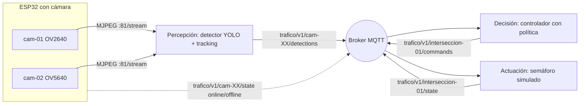

# MVP — Semáforo inteligente con cámaras ESP32

Estado: **borrador del 2026-11-08** (America/Buenos_Aires), con las decisiones D08–D12 confirmadas. Los topics y JSON siguen siendo propuesta hasta implementarse. Hito: presentación informal del **viernes 13/11/2026**. Audiencia: el propio equipo y personas cercanas; no hay requisito formal.

Este documento define **qué se muestra el 13/11 y qué no**. La referencia técnica larga (hardware, métricas completas, modo local, decisiones P01–P08) sigue en [README.md](README.md). Si hay conflicto, para el 13/11 manda este documento; después se reconcilian.

Leyenda de estado: **Existe** (código presente; no implica verificado en esta máquina), **Parcial**, **Falta**, **Propuesta** (decisión pendiente de confirmar).

## 1. Visión

Semáforos que se adaptan al tránsito real en lugar de seguir un ciclo fijo: cámaras de bajo costo (ESP32) observan cada acceso, un sistema detecta los vehículos y decide a quién dar paso.

## 2. Problema

Los semáforos tradicionales son rígidos: se programan una vez y no reaccionan a la demanda. Resultado típico: esperar minutos en un cruce vacío. El MVP busca demostrar que con hardware accesible y detección por visión se puede reducir esa espera injustificada.

## 3. Objetivo del MVP

Demostrar de punta a punta, con estabilidad, el recorrido **cámara → detección → mensaje MQTT → decisión → semáforo (simulado)**, y la solidez de la arquitectura y de la comunicación entre componentes. Lo no estable queda fuera.

Prioridades declaradas por el propietario: (1) arquitectura y comunicación sólidas, (2) precisión de detección, (3) mejora del flujo.

## 4. Alcance

### Entra
- Dos accesos, cada uno con una cámara ESP32: ESP32-CAM con OV2640 y ESP32-S3 con OV5640 (la segunda sujeta a D12).
- Stream MJPEG de cada cámara hacia una PC con YOLO (procesamiento **externo**).
- Seguimiento y conteo de vehículos visibles por acceso.
- Publicación del estado de tráfico por MQTT (broker Mosquitto en la PC).
- Un controlador que decide la fase con una política simple y publica la orden por MQTT.
- Semáforo **simulado** (terminal o página) que ejecuta la orden.
- Modo seguro: si faltan datos, ciclo fijo.
- Registro (JSONL) de detecciones y decisiones como evidencia.

### Queda fuera
- Inferencia local en el ESP (D04 sigue vigente como objetivo futuro; no es parte del MVP).
- Semáforos físicos con LEDs (opcional si sobra tiempo).
- ESP-NOW, BLE para configuración, alimentación por baterías.
- Onda verde, vehículos prioritarios, peatones, separación vehículo detenido/estacionado, órdenes manuales de un administrador.
- Métricas de espera y flujo por zonas/líneas (`waiting_count`, `crossings_count`): requieren decisiones P05/P06. El MVP usa solo `visible_count`.
- Docker, base de datos, interfaz administrativa.

## 5. Hipótesis

Con cámaras ESP32 de bajo costo y un servidor de inferencia se puede detectar y contar el flujo vehicular lo bastante bien como para ajustar los tiempos de fase casi en tiempo real.

Riesgos conocidos (documentados en el vault de estudio): ruido de detección por objetos no vehiculares en el cuadro con YOLOv8n; pocos FPS por límites de hardware y WiFi; resolución inicial QVGA en el firmware; potencia USB insuficiente en el S3.

## 6. Actores

| Actor | En el MVP |
| --- | --- |
| Tráfico liviano (bicicleta, auto, moto, colectivo, camión) | Sí: se detecta y cuenta |
| Operador de la demo | Sí: arranca componentes y observa |
| Tráfico prioritario, peatón, administrador | Fuera |

## 7. Arquitectura general

Tres responsabilidades separadas que solo se comunican por MQTT. Pueden ejecutarse como procesos distintos en la misma PC.

Topics (**Propuesta**, derivados de la sección 6 de [README.md](README.md) y del contrato en [protocol/mqtt](../protocol/mqtt/README.md)):

| Topic | Publica | Contenido | QoS / retención |
| --- | --- | --- | --- |
| `trafico/v1/<camera_id>/detections` | Detector | `visible_count` por clase y total, `seq`, `session_id`, `status` | 0 / sin retención |
| `trafico/v1/<camera_id>/state` | ESP (con Last Will) | online/offline, IP, RSSI | 1 / retenido |
| `trafico/v1/interseccion-01/commands` | Controlador | fase por acceso, duración, motivo | 1 / sin retención |
| `trafico/v1/interseccion-01/state` | Semáforo | fase efectiva | 1 / retenido |

Reglas del contrato: un frame válido sin vehículos publica ceros; una cámara o inferencia caída publica `status: unavailable`, nunca ceros.

## 8. Requerimientos funcionales

Prioridad MoSCoW: **M** debe, **S** debería, **C** podría.

| ID | Requerimiento | Prio | Estado |
| --- | --- | --- | --- |
| RF-01 | Cada ESP-CAM expone stream MJPEG (`:81/stream`) y captura (`/capture`) por WiFi | M | Existe; sin verificar en Linux/PlatformIO |
| RF-02 | El detector consume una URL de stream y detecta bicicleta, auto, moto, colectivo y camión | M | Existe (`detect_esp32cam.py`) |
| RF-03 | Seguimiento por cámara con IDs persistentes y estado separado por cámara | M | Parcial (`cam_detection.py`; semántica de conteos a corregir) |
| RF-04 | El detector calcula `visible_count` por acceso | M | Implementado 2026-11-08 (cuenta todas las cajas, con o sin ID); sin verificar con YOLO real |
| RF-05 | El detector publica el estado cada 1 s por MQTT con identidad, `seq` y `session_id` | M | Implementado 2026-11-08 (`traffic_mqtt.py`, `--mqtt-host`); tests de payload OK, sin verificar contra broker |
| RF-06 | El detector acepta una fuente alternativa (archivo de video o webcam) como acceso | S | Existe en esencia (OpenCV acepta archivos); a verificar |
| RF-07 | El ESP publica `online/offline` (Last Will) y datos de red | S | Falta |
| RF-08 | El controlador se suscribe a los accesos y publica la fase por MQTT | M | Falta |
| RF-09 | Política MVP: ciclo base; verde mínimo y máximo; el acceso con mayor demanda suavizada recibe el verde; amarillo y todo-rojo fijos | M | Falta; política acordada en D11, parámetros por definir |
| RF-10 | Modo seguro: sin dato vigente (más de T s) el controlador usa ciclo fijo y lo declara | M | Falta |
| RF-11 | Semáforo simulado que muestra la fase vigente y rechaza secuencias inseguras | M | Falta |
| RF-12 | Vista de demo: video anotado, conteos por acceso y fase actual | S | Parcial (`--show` dibuja cajas y conteo) |
| RF-13 | Registro JSONL de detecciones y decisiones | S | Parcial (`--jsonl` para detecciones) |
| RF-14 | Comparación sobre grabación: espera media con ciclo fijo frente a ciclo adaptativo | S | Falta |
| RF-15 | LEDs físicos para el semáforo | C | Falta; fuera salvo que sobre tiempo |

## 9. Requerimientos no funcionales

| ID | Requerimiento | Criterio |
| --- | --- | --- |
| RNF-01 | Desacople: percepción, decisión y actuación solo se comunican por MQTT | Cada proceso se reinicia sin reiniciar los otros |
| RNF-02 | Robustez: caída de cámara, WiFi o broker no cuelga el sistema | Estado explícito y recuperación al volver; probado en ensayo |
| RNF-03 | Latencia cámara → orden | Medirla en el ensayo y registrar el valor; no se fija un objetivo sin medición previa |
| RNF-04 | Precisión de detección | Comparar conteo del sistema con conteo manual sobre un clip de maqueta; reportar el error observado |
| RNF-05 | Seguridad básica | Broker sin autenticación solo en red privada de laboratorio; sin credenciales en Git |
| RNF-06 | Reproducibilidad | Python 3.12, dependencias declaradas, modelo YOLO descargado antes de la demo (sin depender de internet) |
| RNF-07 | Portabilidad de arranque | Pasos documentados: [setup-linux.md](setup-linux.md) y [setup-windows.md](setup-windows.md) |
| RNF-08 | Observabilidad | Logs con `camera_id`, `seq` y motivo de cada decisión |

## 10. Incrementos hasta el 13/11

Orden pensado para que, si algo falla, lo recortado sea lo último de la lista.

| Hito | Fecha objetivo | Cierre verificable |
| --- | --- | --- |
| M0 — Entorno y cámara estable | dom 8 – lun 9 | Stream de la ESP32-CAM visible en navegador y detector con `--show` sobre ese stream, en esta máquina |
| M1 — Detector → MQTT | mar 10 | `mosquitto_sub` recibe JSON real del detector, sin publicar a mano |
| M2 — Controlador y semáforo simulado | mié 11 | La fase cambia según la demanda y vuelve a ciclo fijo al cortar la fuente |
| M3 — Segundo acceso y vista de demo | jue 12 | Dos accesos simultáneos (S3 o fuente alternativa) y panel con conteos y fase |
| M4 — Ensayo y respaldo | jue 12 – vie 13 | Ensayo completo cronometrado, video grabado de respaldo, conteo manual vs sistema |

Orden de recorte si falta tiempo: RF-14, RF-12, segundo acceso en tiempo real (usar video), RF-07.

## 11. Decisiones (D08–D12 confirmadas por el propietario el 2026-11-08)

| ID | Decisión | Motivo |
| --- | --- | --- |
| D08 | Separar percepción, decisión y actuación y unirlas solo por MQTT | Arquitectura defendible, reemplazable por pieza y compatible con mover luego la percepción al ESP |
| D09 | En el MVP el ESP solo captura, transmite y declara su estado; no calcula métricas ni infiere | La inferencia en ESP32 no es realista a corto plazo; D04 queda como objetivo posterior |
| D10 | Semáforo simulado por software | No hay LEDs ni electrónica; la electrónica va al final (ToDo del vault) |
| D11 | Política mínima de prioridad acotada al MVP, con excepción explícita al I6 de [README.md](README.md) | Sin alguna política no hay "decisión" que mostrar; no se declara equidad ni política definitiva |
| D12 | El S3/OV5640 entra solo si se valida su pinout y alimentación; si no, el segundo acceso usa video o webcam | Los datos físicos de esa placa siguen pendientes (P01) y el sketch de Arduino solo probó el modelo AI Thinker |

## 12. Documentación relacionada que no se incluye aquí

Quedan para documentos aparte, como indica el boceto del vault: interfaces detalladas (contrato JSON completo), hardware y software, criterios de aceptación y plan de pruebas, riesgos y mitigaciones, guion de demo y plan de contingencia.
