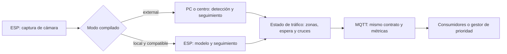

# Sistema de detección y estado del tráfico con ESP

Última actualización: 21/10/2026. Documento central de requisitos, arquitectura, hardware, puesta en marcha, problemas pendientes y validación. Consolida la información anteriormente distribuida en cuatro documentos de `docs/`.

**Estado:** la arquitectura y el contrato que se proponen a continuación todavía requieren implementación. El código actual transmite vídeo desde el ESP y ejecuta detección en Python; no integra MQTT en cámara/visión ni calcula todavía cola o flujo de tráfico.

## 1. Objetivo y prioridades acordadas

Desarrollar un sistema escalable que detecte presencia de vehículos, determine cuántos esperan y cuente pasos sin duplicados para describir el flujo por acceso/carril. Las pruebas incluyen vehículos de maqueta y tráfico real, que deben validarse por separado.

La ubicación del procesamiento será **configurable al compilar y cargar el firmware**, según el hardware y el modelo disponible:

- `external`: el ESP captura imágenes; una PC o centro de cómputo ejecuta detección, seguimiento y métricas, y publica el estado del tráfico por MQTT.
- `local`: un ESP compatible integra captura, inferencia, seguimiento/métricas y publicación MQTT. Los modelos y métricas soportados deben validarse para esa placa.

Los nombres son una propuesta de configuración; el selector todavía no existe en el código. El requisito de poder elegir el lugar de procesamiento sí está acordado. La prioridad actual es desarrollar funcionalidades y esa arquitectura; optimizar CPU/GPU, elegir compras o aumentar FPS no son condiciones previas para comenzar.

El desarrollo del simulador `firmware/sensor-controller` está pausado. Conservamos sus configuraciones de hardware y experiencia MQTT como referencia. No es necesario corregir su máquina de estados, compilarlo o eliminarlo de CI para avanzar con cámara/visión.

El primer hito es **captura → detección → MQTT**. El siguiente incluye cantidades esperando y flujo con seguimiento y reglas de conteo. Mostrar cajas o transportar un snapshot de clases no completa por sí solo ese segundo hito. La política que asigna prioridad y la actuación física del semáforo necesitan una especificación propia.

## 2. Inventario y configuraciones de hardware

### Dispositivos físicos informados

| Cantidad | Equipo                              | Papel y validaciones pendientes                                                                            |
| -------- | ----------------------------------- | ---------------------------------------------------------------------------------------------------------- |
| 1        | ESP-32S, OV2640 y base ESP32-CAM-MB | Captura/transmisión; confirmar pinout y PSRAM detectada antes de equipararlo al perfil `esp32cam`          |
| 1        | ESP32-S3-N16R8 y OV5640             | Captura y candidato para procesamiento local; falta identificar placa portadora, pinout y memoria efectiva |
| 1        | ESP32 NodeMCU                       | Referencia y pruebas MQTT; no se informó una cámara conectada                                              |

Inventario informado por el propietario; no equivale a validación física del agente. En la variante ESP32-S3-WROOM-1-N16R8, Espressif documenta 16 MB de flash y 8 MB de PSRAM. Flash almacena firmware/modelos y RAM aloja datos y tensores: no son intercambiables ni indican por sí solas velocidad de inferencia. N16R8 no define los GPIO de la cámara. [Hoja de datos oficial](https://documentation.espressif.com/esp32-s3-wroom-1_wroom-1u_datasheet_en.pdf).

Por placa se debe registrar modelo, cámara, pines, flash/PSRAM, alimentación, adaptador USB/serie, procedimiento de carga/reset y entorno de compilación. No trasladar automáticamente los pines del circuito ultrasónico a una cámara.

### Computadoras disponibles

| Equipo               | Configuración informada                                                     | Uso posible                                                                |
| -------------------- | --------------------------------------------------------------------------- | -------------------------------------------------------------------------- |
| PC                   | Intel i5-9600K, 16 GB RAM, NVIDIA RTX 2060 con 6 GB GDDR6 y bus de 192 bits | Procesamiento externo, desarrollo y pruebas                                |
| Notebook HP Pavilion | Ryzen 7 5700U, 8 GB RAM y Radeon integrada con 496 MB gráficos reportados   | Desarrollo y pruebas portátiles; capacidad y aceleración se validan aparte |

En el entorno virtual revisado se observó `torch 2.14.0+cpu`, `torch.version.cuda = None` y CUDA no disponible para PyTorch. Eso describe la instalación, no ausencia de GPU física. Aprovechar CUDA en la PC queda como mejora posterior; CPU sigue siendo una ruta válida para desarrollar y comprobar funcionalidades sin prometer rendimiento.

### Perfiles de cámara declarados en el repositorio

| Entorno actual | Configuración declarada                                                                                                 |
| -------------- | ----------------------------------------------------------------------------------------------------------------------- |
| `esp32cam`     | `board = esp32cam`, `CAMERA_MODEL_AI_THINKER`; COM5 como ejemplo local                                                  |
| `esp32s3`      | `board = esp32-s3-devkitc-1`, `CAMERA_MODEL_ESP32S3_EYE`, memoria `qio_opi`, `BOARD_HAS_PSRAM`; COM6 como ejemplo local |

El perfil S3 no demuestra que la placa N16R8 del usuario sea una S3-EYE. Contrastar los pines reales antes de cargar. `partitions.csv` termina en 4 MiB y no se declara explícitamente flash de 16 MB en `platformio.ini`: revisar esa distribución al incorporar modelos. Una tabla de 4 MiB puede bastar para vídeo y no prueba un fallo de compilación.

El servidor configura inicialmente JPEG a QVGA. La OV5640 no está necesariamente transmitiendo a su resolución máxima. El driver admite OV2640 y OV5640 y documenta el costo de RGB/YUV, PSRAM, WiFi y múltiples buffers: la captura y la inferencia simultáneas necesitan una prueba conjunta. [Driver oficial de cámara](https://github.com/espressif/esp32-camera#readme).

### Circuito histórico de sensores

`diagram.json` contiene ESP32 DevKit, HC-SR04, tres LEDs discretos y TM1637. `src/main.cpp` construye `Sensor(16, 17, 18, 5, 14, 0, 4)`. Las operaciones del display están comentadas; la bitácora registra su ausencia en pruebas físicas. El README histórico menciona PIR y LEDs RGB que no corresponden al diagrama actual. Este circuito es referencia del desarrollo pausado, no el cableado de las cámaras.

## 3. Estado actual comprobado en el repositorio

| Componente                                                  | Qué existe                                                                             | Qué falta para el objetivo                                                                       |
| ----------------------------------------------------------- | -------------------------------------------------------------------------------------- | ------------------------------------------------------------------------------------------------ |
| [camera-server](../firmware/camera-server/)                 | Credenciales por perfil, inicialización de cámara, web, captura y MJPEG                | Selector externo/local, backend de inferencia local y cliente MQTT                               |
| [detect_esp32cam.py](../vision/detector/detect_esp32cam.py) | Una URL, YOLO, filtro de cinco clases, anotaciones y vídeo opcional                    | Datos estructurados comunes, seguimiento/métricas funcionales y MQTT                             |
| [cam_detection.py](../vision/detector/cam_detection.py)     | IDs de tracking, conteos y snapshots JSON/JSONL                                        | Corregir semántica de conteos, zonas, espera, cruces y MQTT; estaba sin versionar en la revisión |
| [pyproject.toml](../vision/detector/pyproject.toml)         | Python `>=3.11,<3.14`, NumPy, OpenCV y Ultralytics                                     | Empaquetado explícito de ambos módulos y dependencias de MQTT/seguimiento verificadas            |
| [MQTT legado](../protocol/mqtt/README.md)                   | Diagnóstico y `Detener` en `sensor-controller`                                         | Contrato para tráfico, identidades y recuperación compartido por ambos modos                     |
| CI                                                          | Compila los tres entornos de firmware y verifica sintaxis/ayuda del detector principal | Pruebas funcionales de contratos, métricas y modos; instalación/ayuda de ambos scripts           |

Los proyectos PlatformIO son independientes. No existe un backend MVC, base de datos ni persistencia central implementada. Docker no es requisito; `.devcontainer/` no existe aunque `CONTRIBUTING.md` todavía lo describe. Las dependencias no están completamente fijadas, por lo que la reproducibilidad debe registrarse al validar versiones.

## 4. Arquitectura objetivo con dos modos de procesamiento

### Responsabilidades compartidas

Separar captura, proveedor de detecciones, seguimiento, métricas, configuración e intercambio MQTT. La separación responde a la necesidad concreta de dos ubicaciones de procesamiento; no requiere crear servicios genéricos o capas adicionales para cada operación.



Es un diagrama de responsabilidades lógicas: en `local`, seguimiento y métricas también residen en el ESP; en `external`, residen en el centro. Compartir contrato y casos de prueba no significa ejecutar Python/PyTorch dentro del microcontrolador ni copiar sin adaptación todo el algoritmo entre runtimes.

| Aspecto                              | `external`                                                                | `local`                                                                     |
| ------------------------------------ | ------------------------------------------------------------------------- | --------------------------------------------------------------------------- |
| Captura                              | ESP                                                                       | ESP                                                                         |
| Transporte de imagen para inferencia | HTTP/MJPEG hacia el centro                                                | No requiere enviar imágenes para procesarlas; vista de diagnóstico opcional |
| Detección, seguimiento y métricas    | PC o centro de cómputo                                                    | ESP, con implementación y modelo compatibles                                |
| Publicación del estado de tráfico    | Proceso externo identificado por cámara                                   | ESP identificado por cámara                                                 |
| Estado del dispositivo               | ESP por MQTT, al implementarlo                                            | ESP por MQTT                                                                |
| Si falla el procesador               | Declarar resultados no disponibles y conservar captura cuando sea posible | Declarar error local; no publicar conteos inventados                        |

El broker continúa siendo un servicio MQTT de la red; integrar funciones en el ESP no implica ejecutar Mosquitto en él. USB programa y permite consultar el monitor serie; el vídeo actual se transmite por WiFi.

### Selección al compilar y cargar

Propuesta de parámetro lógico: `processing_mode = external | local`, separado del perfil físico de placa/cámara. Su representación definitiva en PlatformIO, macros o configuración generada se define al implementar; no es una opción disponible hoy.

Podrían existir perfiles como `esp32cam-external`, `esp32s3-external` y `esp32s3-local`, reutilizando configuración física. Son nombres propuestos, **no entornos ejecutables actuales**. Seleccionar un perfil determinará qué backend se incluye en el firmware antes de la carga.

La configuración debe cubrir identidad del dispositivo/cámara, perfil físico, modo, modelo/backend y capacidades, red, broker y parámetros de métricas. Un nodo local debe declarar qué métricas soporta realmente: detectar presencia no equivale a implementar espera y flujo.

- Una combinación no soportada debe rechazarse en la validación previa a la carga cuando pueda detectarse allí, con diagnóstico del chip/modelo/memoria o función faltante.
- No cambiar silenciosamente de `local` a `external` ni publicar ceros para funciones no implementadas.
- Los nodos de ambos modos deben poder coexistir y publicar resultados identificables con las mismas definiciones funcionales.
- Un cambio de modo o reinicio debe delimitar sesiones y evitar dos publicadores activos contando el mismo origen sin coordinación.
- La recepción del estado de fase y el retorno de resultados al ESP se especifican por separado. No son sinónimos de cambiar el lugar de inferencia.

### Procesamiento externo escalable

Los scripts actuales aceptan una sola URL y crean un objeto YOLO por ejecución. Se puede evolucionar hacia un servicio con captura independiente por fuente, modelo compartido, colas acotadas y estado/trackers separados por cámara. No alternar cámaras en el `model.track(..., persist=True)` actual sin separar contextos. Una cámara caída no debe bloquear a las demás.

Ultralytics admite varias fuentes y lotes, incluidas listas `.streams`; los scripts actuales no adquieren ese soporte simplemente recibiendo ese archivo. Un modelo compartido evita duplicación, pero el trabajo sigue creciendo con las imágenes procesadas. La demanda aproximada es `N × f` imágenes por segundo para `N` cámaras y `f` inferencias por cámara. Es un presupuesto, no un benchmark. [Inferencia con varias fuentes](https://docs.ultralytics.com/modes/predict/).

Separar frecuencia de captura, inferencia y publicación MQTT. Reducir frecuencia o resolución exige comprobar que no se pierdan cruces o vehículos pequeños. `classes=[...]` filtra categorías y `max_det` limita resultados; no convierten una red general en un modelo pequeño específico de vehículos. Estos son criterios posteriores de capacidad, no el foco del incremento actual.

### Procesamiento local y compatibilidad

El S3 es candidato para una prueba de modelo pequeño especializado, no una garantía de que el pipeline completo ya quepa o alcance precisión. ESP-DL distingue el ESP32 clásico sin instrucciones PIE del S3 con PIE V1. [Operadores y plataformas](https://github.com/espressif/esp-dl/blob/master/operator_support_state.md).

ESP-Detection ofrece modelos ESPDet-Pico y entrenamiento para objetivos específicos. Publica más de 7 FPS a 224 × 224 para un ejemplo en S3; ese resultado no demuestra cinco clases de vehículos, seguimiento, cámara y MQTT simultáneos. Su flujo documentado usa ESP-IDF para despliegue, por lo que no se debe asumir integración directa sin cambios al firmware Arduino actual. [ESP-Detection](https://github.com/espressif/esp-detection#readme).

ESP-DL usa modelos `.espdl` y herramientas de cuantización. Se requieren datos representativos, entrenamiento/ajuste o modelo adecuado, exportación, operadores compatibles y validación de memoria/precisión. Entrenar fuera del ESP no significa necesitar ese centro para cada inferencia posterior. El archivo `.pt` y los scripts Python actuales no se ejecutan directamente en el ESP. [ESP-DL](https://github.com/espressif/esp-dl#readme).

Como contraste de límites, los benchmarks de YOLO26n en ESP-DL muestran configuraciones S3 con 16 MB de PSRAM y latencias del orden de segundos a 512/640 píxeles. No equivalen al R8 ni al YOLOv8n actual. Probar un modelo pequeño especializado y el pipeline completo; no prometer rendimiento por la etiqueta «compatible con YOLO». [Benchmarks YOLO26](https://github.com/espressif/esp-dl/blob/master/models/yolo26/README.md).

Un solo S3 no se considera por defecto procesador de las cámaras de otros ESP. Las reglas simples de diferencias de imagen/ocupación pueden investigarse en escenas controladas, pero sombras, vibración e iluminación alteran resultados; un vehículo detenido también debe detectarse. La activación por movimiento necesita revisión periódica para no olvidar vehículos inmóviles.

## 5. Definición de las métricas de tráfico

| Métrica propuesta | Qué significa                                  | Implementación necesaria                                       |
| ----------------- | ---------------------------------------------- | -------------------------------------------------------------- |
| `visible_count`   | Vehículos observados ahora en un acceso/carril | Región de interés, objetos válidos y eliminación de duplicados |
| `waiting_count`   | Vehículos observados que esperan               | Zona de espera y condición temporal de detención/avance lento  |
| `crossings_count` | Pasos válidos durante un intervalo             | Línea/zona, trayectoria, dirección y deduplicación de eventos  |
| `flow_rate`       | Intensidad de circulación                      | Cruces divididos por una ventana explícita, con unidades       |

No sumar snapshots de cola: un vehículo detenido durante cien imágenes representa una unidad esperando en cada instante. Si cruzan 12 vehículos en 30 segundos, el volumen observado es 12 y la tasa equivalente es 24 vehículos/minuto; no implica 24 cruces ya observados.

### Zonas, espera y cobertura

Cada cámara necesita asociarse a accesos/carriles, regiones de espera y líneas de cruce con dirección. Una cámara puede cubrir varias zonas o varias cámaras pueden observar regiones distintas; depende de la instalación. Propuesta a validar: usar un punto de referencia como la parte inferior central de la caja y tolerancias frente al ruido de detección. [Conteo por regiones](https://docs.ultralytics.com/guides/region-counting/) y [conteo por línea/zona](https://docs.ultralytics.com/guides/object-counting/).

Para espera falta acordar zona, duración mínima, umbral de movimiento, tratamiento de avance lento/detenciones transitorias y persistencia estimada ante oclusiones breves. Los píxeles dependen de perspectiva, resolución y frecuencia; no equivalen a velocidad física sin calibración. Distinguir observación reciente de estado estimado.

Si la cola continúa fuera del encuadre o hay vehículos ocultos, el conteo visible no demuestra la longitud completa de la cola. Documentar cobertura y calidad de observación. Ausencia de detecciones y ausencia física no son equivalentes garantizados.

### Unicidad y sesiones

Propuesta pendiente de confirmar: un conteo por paso válido en un acceso/carril y una sesión. Para cantidad presente, mantener una representación por trayectoria activa, sin acumular cada detección. Un `track_id` es una identidad temporal estimada y puede cambiar tras oclusiones o reconexiones; no garantiza identidad física permanente. [Seguimiento de Ultralytics](https://docs.ultralytics.com/modes/track/).

Definir dirección y tolerancia al cruce, si un vehículo que regresa produce otro evento, tratamiento de reinicios/sesiones y continuidad de agregados. Si las vistas se solapan, sumarlas puede duplicar vehículos sin asociación entre cámaras. También se debe acordar tolerancia a omisiones y duplicados: deduplicación de mensajes no demuestra conteo físico perfecto.

Los resultados necesitan identificar dispositivo/cámara, acceso/carril, sesión, secuencia y tiempo/ventana. Cada evento de cruce requiere identidad propia para no sumarlo dos veces por una entrega MQTT repetida. Mantener seguimiento y estado por cámara y zona.

### Prioridad y fase efectiva

La salida inicial es telemetría de espera, cruces, tiempos y salud. La política de prioridad todavía no define equidad, espera máxima ni cambios de fase. Una ponderación futura distinta para colectivos o bicicletas es una regla de gestión, no una modificación del conteo físico.

Para etiquetar el flujo como «durante el verde» hace falta conocer la fase efectiva desde una fuente autoritativa, aún no definida. Mientras falte, medir por tiempo y publicar fase desconocida, sin deducirla solo del movimiento.

### Diferencia respecto de los scripts

El detector simple carece de seguimiento, zonas y métricas de espera/cruce. En `cam_detection.py`, `current` cuenta tracks del frame y no representa espera. `unique_total` registra primeras apariciones y puede recontar un ID eliminado por TTL. `unique_window` se basa en primeras apariciones, no en todas las presencias ni en salidas. Estas métricas no deben publicarse como unicidad física o flujo sin corregirlas/definirlas.

Ambos scripts fijan `max_det=30` e `imgsz=320`; revisar truncamiento en escenas densas y calidad con vehículos lejanos, considerando además la captura inicial QVGA. El seguimiento solo añade a `current` cajas con ID: decidir cómo tratar detecciones aún sin ID. Mantener el script simple como diagnóstico es compatible con desarrollar un pipeline funcional común.

## 6. Comunicación MQTT y contrato común

No existe publicación MQTT en cámara/visión. El legado de sensores usa un único tópico `semaforo/esp32`, diagnóstico y la orden `Detener`, sin autenticación/TLS ni contrato estable. No reutilizar esa orden como resultado de visión.

Propuesta de tópicos por origen, todavía no implementada:

| Tópico de ejemplo              | Publicador                                 | Función                                     |
| ------------------------------ | ------------------------------------------ | ------------------------------------------- |
| `trafico/v1/cam-01/detections` | Procesador externo o ESP local, según modo | Snapshot de observaciones y métricas        |
| `trafico/v1/cam-01/state`      | ESP                                        | Salud, modo, capacidades y estado de cámara |

Separar eventos de cruce, órdenes y estado efectivo cuando se definan sus contratos. No mezclar diagnóstico con comandos ni crear un canal de actuación sin requerimiento. El consumidor debe identificar origen y no depender de que el procesamiento sea Python o C++.

Ejemplo ilustrativo de snapshot; **no es una API aprobada ni la salida actual**:

```json
{
  "v": 1,
  "device_id": "cam-01",
  "camera_id": "cam-01",
  "approach_id": "acceso-01",
  "processing_mode": "external",
  "producer_id": "vision-cam-01",
  "session_id": "sesion-ejemplo-01",
  "seq": 1,
  "processed_at": "2026-10-21T12:00:00Z",
  "status": "ok",
  "metrics": {
    "visible_count": 4,
    "waiting_count": 3,
    "crossings_count": 12,
    "window_s": 30,
    "flow_rate_vehicles_per_minute": 24
  }
}
```

Puede agregarse desglose por clase y carril con las definiciones acordadas. `processed_at` es procesamiento, no captura. Si el reloj del nodo local no está sincronizado, definir explícitamente la base temporal; no inventar una hora UTC. `session_id` distingue ejecuciones y `seq` ordena snapshots dentro de ellas.

Propuesta inicial: un snapshot por segundo, QoS 0 y detecciones sin retención; frecuencia, vigencia y política final quedan por confirmar. No reproducir una acumulación de datos antiguos como tráfico actual al recuperar conexión. Un frame válido vacío produce ceros; stream caído, inferencia fallida o métrica no soportada producen estado no disponible, no cero. El receptor valida identidad, versión, duplicados y vigencia.

### Configuración y ciclo de conexión

El ESP necesita host/IP LAN alcanzable del broker; `localhost` en él no identifica la PC. Python puede usar `127.0.0.1` si broker y proceso están en la misma computadora y el listener lo admite. IP de cámara y dirección del broker son distintas.

Cada placa y cada proceso MQTT requieren identificadores de cliente distintos y asociación estable entre identidad de cámara y URL. La IP puede cambiar sin cambiar el origen lógico. Configurar puerto, tópicos y credenciales según el broker, evitando secretos reales en Git.

El antiguo `Broker` sirve como referencia pero contiene ID/tópico fijos, ignora `MQTT_TOPIC`, publica mensajes de prueba y pausa un segundo por ciclo. Además, tras timeout inicial de WiFi puede intentar reconectar sin haber inicializado MQTT. No trasladar esos comportamientos al nuevo firmware.

Inicializar el cliente aunque WiFi aún no esté disponible y reconectar sin esperas largas que paralicen captura/inferencia. El `loop()` actual de cámara duerme 10 segundos: no es un ritmo apropiado para atender el futuro cliente MQTT. La caída del broker no debe impedir capturar ni declarar correctamente la ausencia de resultados.

Agregar la dependencia del cliente Python en `pyproject.toml` y la del firmware donde corresponda. Actualizar ejemplos y generación de configuración en [CI de firmware](../.github/workflows/platformio.yml) al añadir parámetros.

## 7. Problemas fundamentales pendientes

| Área                      | Acción necesaria                                                                 | Evidencia de cierre                                                               |
| ------------------------- | -------------------------------------------------------------------------------- | --------------------------------------------------------------------------------- |
| Hardware                  | Contrastar placa/pines/memorias con perfiles y particiones                       | Arranque, captura y carga física registrados por placa                            |
| Selector de procesamiento | Implementar elección de modo al compilar, backend y validación de compatibilidad | Perfiles válidos funcionan; combinaciones no soportadas fallan de forma explícita |
| WiFi/HTTP                 | Configurar perfil `LOCAL`, diagnosticar fallos y comprobar servicios reales      | Página, captura y stream alcanzables desde la red                                 |
| Instalación Python        | Declarar los dos módulos o crear un paquete explícito                            | Instalación desde entorno limpio y ayuda/inferencia de ambos scripts              |
| MQTT                      | Implementar publicación/estado y configuración en los extremos correspondientes  | Suscriptor independiente recibe datos reales identificados                        |
| Métricas                  | Seguimiento, zonas, espera, cruce y deduplicación                                | Comparación con referencia manual en maqueta y tráfico real                       |
| Backend local             | Modelo/runtime y pipeline completo compatibles por chip                          | Memoria, resultados, recuperación y capacidades comprobados en el ESP             |
| Robustez                  | Tratar pérdidas de frames, WiFi, broker, excepciones y cierre                    | Fallos producen estados explícitos y recuperación comprobada                      |

### Instalación y modelos

En el árbol con ambos scripts, una instalación editable produjo `Multiple top-level modules discovered in a flat-layout: ['cam_detection', 'detect_esp32cam']`. No basta con ejecutar scripts en un entorno ya preparado: resolver el empaquetado y verificar instalación limpia.

Revisar dependencias efectivas de seguimiento: la versión local de Ultralytics usa `lap` para asociar tracks, sin declaración directa en este proyecto. No depender de descargas/instalaciones accidentales en ejecución. Un modelo propio tampoco garantiza el mapa de clases COCO usado para bicicletas, autos, motos, colectivos y camiones.

`yolov8n.pt` puede descargarse al cargarlo si no existe. Para operar sin conexión, disponer previamente del modelo. No versionar modelos descargados, vídeos, entornos ni credenciales.

### Recuperación y observabilidad

La cámara espera WiFi indefinidamente al iniciar y retorna de `setup()` si falla `esp_camera_init`. Diferenciar esos estados de los fallos MQTT. El texto `Camera Ready` no comprueba que todos los servicios HTTP se hayan iniciado: realizar una consulta real.

Los dos detectores reinician el contador de reconexiones cuando la captura abre, aunque nunca entregue frames; se reprodujo que ese caso supera el límite indicado. La apertura inicial fallida tampoco tiene política equivalente de reintento ni código de salida explícito de error. Definir timeouts donde el backend los admita y cerrar captura, vídeo, JSONL y MQTT también ante excepciones o `Ctrl+C`.

`CAP_PROP_BUFFERSIZE = 1` no demuestra que siempre se procese el frame más reciente. Probar imagen nula, captura abierta sin frames, reinicio de cámara y pérdida de red. Distinguir retardo de captura, procesamiento y publicación; no prometer tiempo real con una latencia no medida.

## 8. Puesta en marcha del recorrido actualmente disponible

Comandos desde la raíz en PowerShell. La instalación depende de reparar el empaquetado; la publicación automática y el selector de modo todavía no están implementados. No pasar opciones MQTT, `--device` o perfiles propuestos a los scripts/configuraciones actuales como si ya existieran.

### Entorno Python y PlatformIO

Con Python 3.12 disponible, crear el entorno solo si no existe:

```powershell
py -3.12 -m venv .venv
.\.venv\Scripts\python.exe -m pip install platformio
.\.venv\Scripts\python.exe -m pip install -e .\vision\detector
```

Se puede usar el ejecutable del entorno sin activarlo, evitando bloqueos de scripts PowerShell. Mosquitto se instala aparte. La comprobación `import cv2, numpy, ultralytics` valida importaciones, no inferencia ni MQTT.

### Credenciales, carga y monitor serie

```powershell
if (-not (Test-Path -LiteralPath '.\firmware\camera-server\include\secrets.h')) {
    Copy-Item -LiteralPath '.\firmware\camera-server\include\secrets.h.example' -Destination '.\firmware\camera-server\include\secrets.h'
}
.\.venv\Scripts\python.exe -m platformio device list
```

Completar `WIFI_SSID_LOCAL` y `WIFI_PASS_LOCAL`, porque `main.cpp` selecciona `WifiEnv::LOCAL`. `Wokwi-GUEST` corresponde al ejemplo de simulación y no sustituye la red física. No sobrescribir secretos locales existentes.

Sustituir `COMx`. El ejemplo corresponde solo a hardware compatible con `esp32cam`:

```powershell
$cameraEnv = 'esp32cam'
$cameraPort = 'COMx'
.\.venv\Scripts\python.exe -m platformio run -d firmware/camera-server -e $cameraEnv
.\.venv\Scripts\python.exe -m platformio run -d firmware/camera-server -e $cameraEnv -t upload --upload-port $cameraPort
.\.venv\Scripts\python.exe -m platformio device monitor --port $cameraPort --baud 115200
```

Usar el entorno actual `esp32s3` únicamente tras confirmar los pines de esa placa/cámara. Seguir su procedimiento físico de carga/reset y cerrar el monitor antes de otra carga si ocupa el puerto. Los COM5/COM6 de ejemplo no son requisitos y no se deben imponer a CI.

### Página, captura y stream

Tomar la IP del monitor: página `http://IP_CAMARA/`, captura `http://IP_CAMARA/capture` y stream `http://IP_CAMARA:81/stream`. La PC debe alcanzar esa IP por la red. Primero probar navegador y detector por separado; cerrar el consumidor de vídeo del navegador antes de probar Python. No dar por validada la concurrencia de varios clientes del stream.

### Detectores actuales

Ejecutar uno por vez, reemplazando `IP_CAMARA` y proporcionando un modelo local si no se admite descarga:

```powershell
.\.venv\Scripts\python.exe vision/detector/detect_esp32cam.py --url http://IP_CAMARA:81/stream --model yolov8n.pt --show
```

```powershell
.\.venv\Scripts\python.exe vision/detector/cam_detection.py --url http://IP_CAMARA:81/stream --model yolov8n.pt --show --emit-every 1
```

`--show` permite salir con `q` o `Esc`; `--save` genera `output.mp4` y `--max-w` limita el ancho. El segundo script puede escribir snapshots con `--jsonl`; no confundir ese archivo ni su salida de consola con publicación MQTT. Una ventana con anotaciones valida solo adquisición e inferencia.

### Broker y prueba manual de transporte

`python -m http.server 1883`, incluido todavía en la documentación del protocolo, crea HTTP y debe corregirse. Se necesita un broker MQTT real.

Para una red privada de laboratorio puede crearse `artifacts/mosquitto.local.conf` con:

```conf
listener 1883
allow_anonymous true
```

Este ensayo permite acceso sin credenciales; si se elige un broker autenticado, configurar ese acceso en ambos extremos. Mosquitto documenta que los valores predeterminados sin listener restringen conexiones al equipo local. El listener y la política deben ser explícitos para conectar ESP desde la red. [Autenticación](https://mosquitto.org/documentation/authentication-methods/) y [configuración oficial](https://mosquitto.org/man/mosquitto-conf-5.html).

Con archivo creado y utilidades en `PATH`, iniciar en una terminal:

```powershell
mosquitto -c .\artifacts\mosquitto.local.conf -v
```

Si un servicio ya ocupa 1883, usar su configuración o detener conscientemente esa instancia antes de iniciar otra. Permitir acceso en la red privada sin desactivar globalmente el firewall. Para probar desde otro equipo o ESP usar la IP LAN del servidor.

En otra terminal escuchar y, desde una tercera, publicar:

```powershell
mosquitto_sub -h 127.0.0.1 -p 1883 -t "trafico/v1/+/detections" -v
```

```powershell
mosquitto_pub -h 127.0.0.1 -p 1883 -t "trafico/v1/cam-01/detections" -m "prueba-manual-de-transporte"
```

Ese texto solo prueba transporte, no contrato JSON ni integración. El cierre del hito requiere recibir datos del procesador real sin publicar manualmente. Si se acuerda retorno al ESP, comprobar el resultado recibido en serie antes de conectarlo a actuadores.

## 9. Pruebas de aceptación y límites de la revisión

| Prueba                               | Evidencia esperada                                                                      |
| ------------------------------------ | --------------------------------------------------------------------------------------- |
| Instalación limpia                   | Ambos scripts disponibles e inferencia sin dependencias accidentales                    |
| Configuración por modo               | Modo y capacidades identificables; combinación inválida rechazada explícitamente        |
| Placa física                         | Entorno, COM, memoria y pines registrados; cámara inicia sin error                      |
| Recorrido externo                    | Imagen desde ESP, detección y estado MQTT con origen correcto                           |
| Recorrido local compatible           | ESP captura, procesa, calcula métricas declaradas y publica, sin PC para inferencia     |
| Compatibilidad de contrato           | Ambos modos usan las mismas definiciones; no exigir cajas idénticas a modelos distintos |
| Vehículo detenido muchos frames      | Una unidad presente/esperando y ningún cruce antes de atravesar la línea                |
| Cola que avanza y oclusiones         | Evolución validada contra referencia manual; observación y estimación distinguibles     |
| Cruce y oscilaciones junto a línea   | Un evento según dirección/regla; medir omisiones y duplicados                           |
| Saturación o vehículos lejanos       | Verificar resolución y truncamiento por límite de detecciones                           |
| Sin vehículos / sin imágenes         | Cero para frame válido vacío; estado no disponible para caída de observación            |
| Reinicios y entregas repetidas       | Sesión y deduplicación consistentes con la política acordada                            |
| Varias cámaras / vistas superpuestas | Seguimiento aislado, orígenes separados y regla explícita de doble observación          |
| Pérdida de cámara o broker           | Diagnóstico, aislamiento y recuperación; sin reproducir datos antiguos como actuales    |

Preparar vídeos de maqueta y tráfico real con referencia manual y evaluar por separado. Reconocer vehículos reales no demuestra reconocer juguetes, ni viceversa. Ajustar o entrenar cuando los errores medidos lo justifiquen. Comparar precisión, duplicados, omisiones, latencia y memoria del pipeline completo, no solo FPS del modelo.

CI debe comprobar builds afectados y contratos/lógica que no necesitan hardware, sin exigir GPU para importar módulos o ejecutar ayuda. No existe todavía una suite funcional que demuestre estas capacidades. Elegir pruebas relevantes del modo, esquema, identidad, conteo y recuperación en vez de reflejar detalles internos.

La revisión anterior verificó sintaxis/configuraciones y ambos comandos de ayuda; reprodujo empaquetado ambiguo, reconteo por TTL y reconexión sin frames. Las compilaciones intentadas quedaron bloqueadas por permisos de la sesión sobre la carpeta global de PlatformIO. No se verificaron cámaras, streams físicos ni la integración propuesta. Esa restricción no demuestra fallo del firmware.

## 10. Información de rendimiento conservada como referencia

Esta información no establece la prioridad de trabajo actual. La capacidad se medirá al validar funcionalidades, sin fijar una cantidad de cámaras por los 6 GB de VRAM ni una frecuencia suficiente para toda escena.

La RTX 2060 está listada por NVIDIA con capacidad CUDA 7.5. Si se decide aprovecharla, elegir driver y distribución PyTorch con soporte para esa arquitectura mediante el selector oficial y validar una inferencia real; la ruta NVIDIA no se traslada a la Radeon de la notebook. [GPU CUDA](https://developer.nvidia.com/cuda/gpus) y [PyTorch](https://pytorch.org/get-started/locally/).

```powershell
.\.venv\Scripts\python.exe -c "import torch; print(torch.__version__); print(torch.version.cuda); print(torch.cuda.is_available()); print(torch.cuda.get_device_name(0) if torch.cuda.is_available() else 'CUDA no disponible')"
```

Es diagnóstico del entorno, no benchmark. Modelos, lotes y resolución deben medirse con red/decodificación/tracking y frames recientes; lotes pequeños no siempre serán superiores al procesamiento alternado. Los scripts no tienen aún `--device`.

Si luego las alternativas disponibles no cumplen, comparar otros nodos o concentradores. Raspberry Pi 5 con AI HAT+ es una opción de inferencia local que requiere modelo/pipeline compatibles y mediciones; no hay evidencia actual que obligue a comprarla. [Referencia de Raspberry Pi](https://www.raspberrypi.com/documentation/accessories/ai-hat-plus.html).

## 11. Orden funcional de desarrollo

Todos los incrementos siguientes están **pendientes**. Son un orden propuesto de desarrollo, no funcionalidades entregadas ni una autorización general para implementar. El estudio acotado de viabilidad local puede adelantarse si resuelve una decisión de arquitectura; no debe bloquear reparaciones o contratos independientes.

| ID                                       | Revisar y decidir                                                                                                            | Implementación posterior                                                                                                            | Condición de cierre                                                                                                           |
| ---------------------------------------- | ---------------------------------------------------------------------------------------------------------------------------- | ----------------------------------------------------------------------------------------------------------------------------------- | ----------------------------------------------------------------------------------------------------------------------------- |
| **I0 — siguiente sesión**                | Configuración de perfil físico/modo/capacidades y contrato mínimo. Separar requisito acordado de nombres/defaults propuestos | Aún es una tarea de planificación; delimitar I1 y sus verificaciones                                                                | Decisión registrada, dudas bloqueantes identificadas y primer incremento suficientemente acotado                              |
| **I1 — base y selección**                | Empaquetado de ambos scripts, representación de selección al compilar y matriz inicial de combinaciones admitidas            | Corregir instalación y agregar selección/configuración explícita manteniendo la ruta externa; rechazar `local` cuando falte soporte | Instalación limpia, builds/configuraciones pertinentes y diagnósticos de combinaciones inválidas; sin fingir inferencia local |
| **I2 — recorrido externo y MQTT**        | Identidad de cámara/productor, salida estructurada y cliente/protocolo definidos en P04                                      | Captura → detecciones → MQTT; estado de dispositivo y recuperación en los extremos que correspondan                                 | Suscriptor independiente recibe resultados reales del origen correcto; vacío y ausencia de observación se distinguen          |
| **I3 — métricas funcionales**            | Zonas, espera, cruces, sesiones y unicidad de P05/P06, con vídeos de referencia                                              | Seguimiento por cámara y métricas de cola/flujo, con eventos deduplicados                                                           | Validación manual/automática separada en maqueta y tráfico real; métricas no implementadas nunca se publican como cero        |
| **I4 — procesamiento local**             | Modelo, runtime, memoria y capacidades del ESP elegido según P01/P03                                                         | Captura, inferencia, estado temporal/métricas y MQTT dentro del ESP compatible                                                      | Evidencia física del pipeline completo y del contrato común; un subconjunto de métricas no se declara cumplimiento total      |
| **I5 — coexistencia y escala funcional** | Sesiones, publicador efectivo, aislamiento y vistas solapadas                                                                | Nodos externos/locales y varias fuentes sin mezclar identidades ni recontar por mensajes repetidos                                  | Fallos/reinicio, productor correcto, aislamiento y capacidades comprobados; sin exigir aún una cantidad arbitraria de cámaras |
| **I6 — gestión del paso**                | Fuente de fase y política de prioridad de P07                                                                                | Integrar fase efectiva y reglas de gestión/actuación únicamente al definirse ese alcance                                            | La salida de telemetría y el control tienen responsabilidades y criterios de aceptación separados                             |

I1 no requiere resolver toda la geometría o política de prioridad. I2 puede probarse con detecciones básicas antes de I3. I4 debe conservar el requisito local a la vista, sin forzar el mismo modelo o código Python que el externo. La evidencia de un modo no prueba el otro. Optimización y expansión de hardware se abordan cuando las funcionalidades y necesidades medidas lo justifiquen.

Para I1, los archivos previsibles son `vision/detector/pyproject.toml`, los módulos de configuración necesarios del firmware, `firmware/camera-server/platformio.ini` y su documentación/checks afectados. La lista es estimada: no prescribe todavía nombres de archivos, macros, nuevos entornos ni una migración de framework. Crear un brief ejecutable después de cerrar las decisiones que afecten ese alcance, no inventarlas como si fueran acuerdos previos.

Estos son incrementos propuestos, no permiso para implementar todos en una solicitud documental. No es necesario reactivar simulación, agregar OTA, crear una interfaz nueva ni introducir base de datos para los primeros hitos.

## 12. Decisiones todavía pendientes

### Registro de decisiones acordadas

| ID  | Decisión vigente del usuario                                                                             | Estado                                                                                            |
| --- | -------------------------------------------------------------------------------------------------------- | ------------------------------------------------------------------------------------------------- |
| D01 | Pausar el desarrollo del simulador y conservar hardware/MQTT como referencia                             | Acordada; no reabrir sin nueva necesidad explícita                                                |
| D02 | Centralizar toda la información de `docs/` en este único Markdown                                        | Aplicada documentalmente                                                                          |
| D03 | Priorizar funcionalidades y arquitectura escalable antes de optimizar recursos de la PC                  | Acordada; CUDA y compras no bloquean la planificación funcional                                   |
| D04 | Seleccionar al compilar/cargar dónde se procesa: externo o local en un ESP compatible                    | Requisito acordado; selector/backend todavía no implementados                                     |
| D05 | Medir presencia, vehículos esperando y conteo de vehículos/pasos para describir flujo y futura prioridad | Requisito acordado; definiciones operativas y tolerancias por cerrar                              |
| D06 | Validar con maqueta y tráfico real                                                                       | Acordada; no extrapolar automáticamente resultados entre escenarios                               |
| D07 | Mantener planificación/revisión con Project Mentor y ejecución de tareas definidas con Coding Agent      | Configuraciones adaptadas; una tarea directa suficientemente definida también permite implementar |

No confundir con acuerdos los nombres de macros/perfiles, el modelo ESPDet-Pico, el uso obligatorio de ESP-IDF, los tópicos/JSON de ejemplo, QoS 0, publicación a 1 Hz, broker local o semántica exacta de unicidad. Son propuestas o referencias que deben evaluarse para el incremento. Tampoco se confirmó todavía que los resultados externos deban regresar al ESP ni quién suministrará la fase efectiva.

### Matriz de decisiones por resolver

| ID                                | Información o decisión necesaria                                                                                    | Qué condiciona                                            | Trabajo independiente que puede continuar                                                               |
| --------------------------------- | ------------------------------------------------------------------------------------------------------------------- | --------------------------------------------------------- | ------------------------------------------------------------------------------------------------------- |
| **P01 — hardware físico**         | Portadora S3, pinout OV5640, memoria efectiva y carga/reset por dispositivo                                         | Validación/carga física del perfil y viabilidad local     | Empaquetado, contratos y pruebas de lógica sin hardware; no inventar pines                              |
| **P02 — selección y capacidades** | Representación de modo al compilar, default, validación de combinaciones y declaración de métricas soportadas       | Configuración de I1 y conexión con backends               | Inspeccionar perfiles y proponer el cambio mínimo; no presentar los perfiles de ejemplo como existentes |
| **P03 — backend local**           | Modelo/runtime, clases, conversión, memoria, captura y estado temporal que permite el chip                          | I4 y cumplimiento funcional local                         | Ruta externa y contrato común; soporte local declarado pendiente/rechazado explícitamente               |
| **P04 — interfaz y red MQTT**     | Contrato mínimo, identidad/eventos, broker/acceso, frecuencia/vigencia, base temporal y necesidad de retorno al ESP | Publicación/consumo interoperable y pruebas físicas de I2 | Parametrización y diseño del esquema; el broker final no obliga a fijar una IP en código                |
| **P05 — geometría y espera**      | Vistas/accesos/carriles, zonas, duración y umbral de espera, avance lento, cobertura/oclusiones                     | `waiting_count` y su validación en I3                     | Captura, detección, diagnóstico y parametrización; no afirmar longitud total de cola no visible         |
| **P06 — unicidad y flujo**        | Regla/dirección de cruce, retorno de un vehículo, sesiones/reinicio, agregados y solapamiento entre cámaras         | Eventos de flujo y deduplicación; significado de «único»  | Seguimiento por cámara y contrato identificado; no prometer identidad física global                     |
| **P07 — fase y prioridad**        | Fuente de fase efectiva, equidad/espera máxima y alcance de actuación                                               | Métricas condicionadas al verde y gestión de I6           | Presencia, espera y cruces por tiempo con fase desconocida; no inferir verde del movimiento             |
| **P08 — aceptación y escala**     | Latencia/calidad aceptables, escenarios anotados y cantidad objetivo al escalar                                     | Criterios finales y capacidad declarada                   | Pruebas de funcionalidad con las dos cámaras; no inventar objetivos de FPS o compras                    |

Resolver primero las filas que afecten el siguiente incremento. Las elecciones rutinarias pueden proponerse fundamentadas; pedir al usuario únicamente datos o decisiones que no puedan obtenerse del repositorio ni resolverse dentro del alcance autorizado. Registrar la elección y su motivo aquí una vez tomada.

## 13. Documentación y coordinación de agentes

`docs/README.md` es el único documento dentro de `docs/`. Mantener aquí requisitos, decisiones, inventario, evidencia y siguientes pasos. No recrear documentos paralelos de hardware, métricas o arquitectura. Los README de componentes y `protocol/mqtt/README.md` siguen existiendo fuera de `docs/` y deben enlazar/alinearse al cambiar sus interfaces.

Pendientes fuera de esta consolidación: retirar instrucciones de `.devcontainer` inexistente en `CONTRIBUTING.md`, corregir HTTP/1883 en el protocolo, alinear rutas/ambos scripts en el README del detector, describir perfiles de IDE realmente disponibles y agregar ejemplos efectivos cuando se implementen. `config/examples/` actualmente contiene solo su README. La documentación histórica del simulador no requiere un rediseño para este incremento.

El Project Mentor analiza y revisa; el Coding Agent implementa una tarea definida. Cuando se solicite un brief o reporte, registrarlo como sección identificada y fechada en este mismo archivo, con creación/última modificación en ISO 8601 y zona horaria. El chat puede enlazar y resumir el resultado; no generar otros `.md` dentro de `docs/` salvo nueva instrucción explícita del usuario.

Un brief debe indicar objetivo, alcance, archivos confirmados/estimados, verificaciones, fuera de alcance y decisiones bloqueantes reales. No generar un brief ejecutable si falta decidir algo que impide implementarlo; avanzar con lo independiente y señalar la duda concreta. La separación de roles no obliga a crear subagentes ni a pedir aprobación redundante para trabajo ya autorizado.
